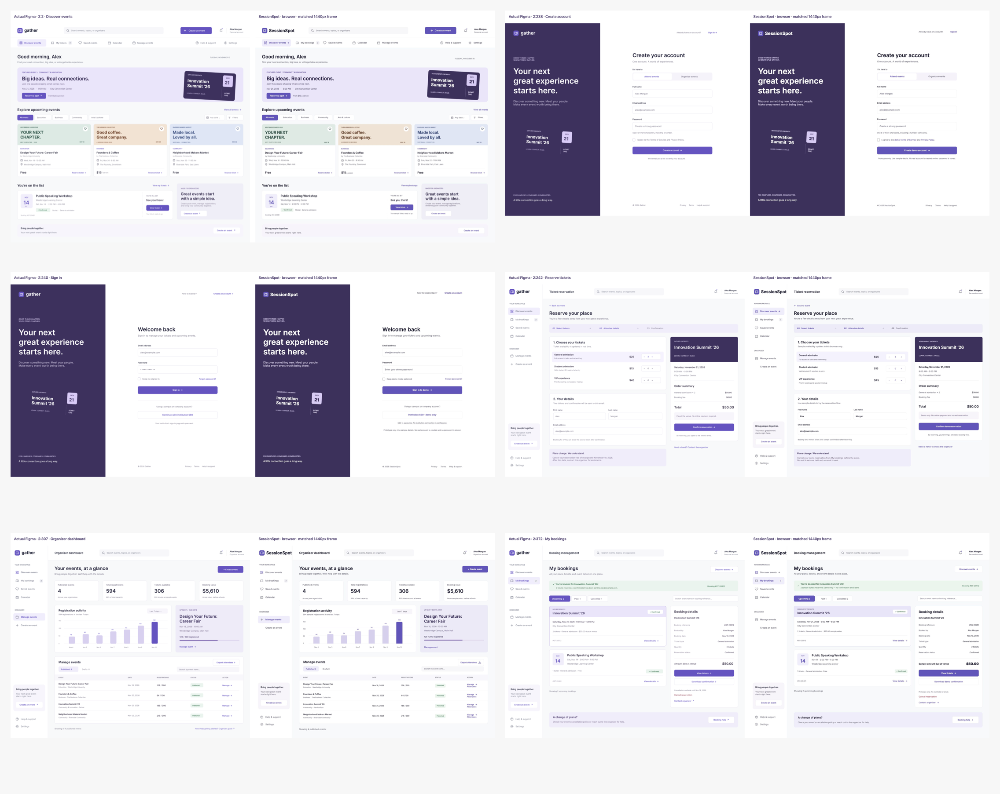

# Actual Figma to SessionSpot mapping

## Verified access and evidence

**Actual Figma access succeeded on November 23, 2026.** The connected account could create a session, read Page 1's layer tree, retrieve full design contexts and rendered images for all six frames, and inventory components/instances. The accessible file is [Gather / SessionSpot](https://www.figma.com/design/R4uts93cpB94GfJPufj2mU/Untitled?node-id=0-1), key `R4uts93cpB94GfJPufj2mU`.

The file contains one page (`0:1`, “Page 1”) and exactly six top-level desktop frames. The user confirmed these are the available references and authorized consistent extensions for the other nine pages. The component/instance query returned an empty list: the reusable visual patterns are ordinary frame/layer groups, not published component instances in this file.

Actual evidence is stored in `qa/figma/page-metadata.xml`, `frames.json`, `*-context.txt`, `*-render.png`, `asset-integrity.json`, `layout-targets.json` and `layout-comparison.json`. Generated React/Tailwind context is retained only as inspection evidence; the application remains plain HTML/CSS/JavaScript. No Figma canvas content was changed.

## Six directly verified pages

| Actual frame / node | Natural frame | HTML | Verification |
| --- | --- | --- | --- |
| [Gather — Discover events · 2:2](https://www.figma.com/design/R4uts93cpB94GfJPufj2mU/Untitled?node-id=2-2) | 1440 × 1320 | index.html | Header/nav, hero, three posters/cards, booking preview, organizer and invitation strip measured and compared |
| [Gather — Create account · 2:238](https://www.figma.com/design/R4uts93cpB94GfJPufj2mU/Untitled?node-id=2-238) | 1440 × 1160 | register.html | 570px marketing pane, Inter typography, 480px form, role segment, fields, checkbox and CTA measured and compared |
| [Gather — Sign in · 2:240](https://www.figma.com/design/R4uts93cpB94GfJPufj2mU/Untitled?node-id=2-240) | 1440 × 1160 | login.html | Split layout, exact form positions/dimensions, divider and SSO control measured and compared |
| [Gather — Reserve tickets · 2:242](https://www.figma.com/design/R4uts93cpB94GfJPufj2mU/Untitled?node-id=2-242) | 1440 × 1160 | reserve.html | Sidebar/topbar, steps, ticket/detail/policy cards, quantity controls and order summary measured and compared |
| [Gather — Organizer dashboard · 2:307](https://www.figma.com/design/R4uts93cpB94GfJPufj2mU/Untitled?node-id=2-307) | 1440 × 1160 | dashboard.html | Four KPIs, chart including seven individual bars, next event and management table measured and compared |
| [Gather — My bookings · 2:372](https://www.figma.com/design/R4uts93cpB94GfJPufj2mU/Untitled?node-id=2-372) | 1440 × 1160 | my-bookings.html | Banner, tabs/search, selected/compact booking cards, details and support panel measured and compared |

Across these six pages, **51 selected component bounds pass a 3px tolerance**; the largest recorded x/y/width/height discrepancy is **2.32px**. This measures those selected layouts, not every glyph or pixel. All six browser images were visually compared with renders obtained from the actual file, not only with the earlier cropped PNGs.

## Nine consistent extensions

No corresponding frame exists for these nine pages. Their shared Inter typography, exported navigation icons, white sidebar/topbar, violet controls, form fields, tables, cards and lavender notices come from the inspected six-frame design system.

| Page | Design-system basis | Status |
| --- | --- | --- |
| event.html | Workspace shell + discovery poster + ticket cards | Implemented and browser-checked extension; no exact frame match claimed |
| confirmation.html | Workspace shell + reservation identity/summary + booking details | Implemented and browser-checked extension; no exact frame match claimed |
| forgot-password.html | Actual sign-in/create-account split and fields | Implemented and browser-checked extension; no exact frame match claimed |
| reset-password.html | Actual sign-in/create-account split and fields | Implemented and browser-checked extension; no exact frame match claimed |
| profile.html | Actual workspace shell + sectioned reservation form controls | Implemented and browser-checked extension; no exact frame match claimed |
| create-event.html | Actual workspace shell + sectioned forms and ticket controls | Implemented and browser-checked extension; no exact frame match claimed |
| attendees.html | Actual workspace shell + organizer table and search | Implemented and browser-checked extension; no exact frame match claimed |
| admin.html | Actual workspace shell + metrics, tables and role controls | Implemented and browser-checked extension; no exact frame match claimed |
| help.html | Actual workspace shell + form card and notice colors | Implemented and browser-checked extension; no exact frame match claimed |

## Measured properties and original assets

- Font family **Inter**; actual normal styles include Regular 400, Medium 500, Semi Bold 600 and Bold 700. Heading sizes include 28px workspace, 32px authentication and 48px marketing; secondary sizes follow the inspected 9–18px hierarchy. The local Inter variable font and license are in `assets/fonts/`.
- Primary violet **#6554c0**, plum **#3d315d**, app background **#f8f9fa**, hero **#eae5fa**, selected navigation **#f0edfc**, auth segment **#f5f3fa**, form border **#dfdce9**, workspace card border **#e2deec**, event border **#e7e7ef**, body **#25243b**, muted **#716c81**.
- Sidebar **224px**, topbar **88px**, discovery secondary nav **60px**, page margins **40px**, grid gaps **24px** (event cards **16px**).
- Discovery hero **1360×208**, event cards **442⅔×319** with **127px** posters, preview **936×176**, organizer panel **400×218** and bottom strip **1360×76**.
- Auth split **570/870px** at 1440; form **480px** at x=765; fields **48px**, main CTA **46px**. Initial signup title y=173 and sign-in title y=251.
- Workspace columns **704/408px** with a **24px** gap; reservation selection **704×321**, details **704×315**, policy **704×105**, summary **408×629**. Dashboard chart/readiness **704×286 / 408×286** and table **1136×405**. Booking cards **704×243 / 704×221**, detail pane **408×612**.
- **17 original SVG exports** were downloaded unchanged and used in the appropriate navigation, brand, poster, date/location/filter and active-state slots. Root dimensions remain 15, 20 or 22px. `asset-integrity.json` records size, dimensions and hashes; `asset-geometry.json` records 140 visible browser callsites passing their rendered-size checks.
- Ticket and poster text/geometry are coded as HTML/CSS from the actual frame properties. Full-page reference images are never used as UI substitutes.

## Deliberate deviations and precision limits

- SessionSpot replaces Gather branding, and SS replaces GT booking references, as requested.
- Authentication, SSO, email, booking, contact and admin wording explicitly describes a frontend demonstration. False service/security claims from the visual prototype were not reproduced.
- Password confirmation is preserved through progressive disclosure after password entry; it is absent from the untouched initial signup composition.
- The featured “from” price is $15 because the real sample student tier is $15, while Figma prints $25. The dashboard's $5,610 now reconciles to the sample ticket mix.
- Data-dependent counts can differ after demo interactions. Testing created a cancelled fictional reservation and archived a fictional test event; existing profile/role edits were restored and pre-existing saved events were retained.
- The date filter retains an accessible native date input with a Figma-style visible caption. Its OS picker and populated state are platform-dependent.
- No mobile/tablet frame exists. Drawer and stacking behavior are responsive extensions, tested at the requested sizes, not exact mobile Figma matches.
- An additional variable-definition request returned the exact error: “You've reached the Figma MCP tool call limit on the Starter plan.” All six high-fidelity contexts and renders had already been saved. Named variable definitions and unreturned constraints are not claimed as inspected.
- Browser screenshot export has a viewport/raster scaling difference. DOM checks used the actual reported CSS viewport; comparison images are normalized to the original 1440px frame dimensions. No pixel-perfect/full-image similarity score is claimed.

## Current comparison boards

- [Discover events](qa/figma/index-comparison.png)
- [Create account](qa/figma/register-comparison.png)
- [Sign in](qa/figma/login-comparison.png)
- [Reserve tickets](qa/figma/reserve-comparison.png)
- [Organizer dashboard](qa/figma/dashboard-comparison.png)
- [My bookings](qa/figma/my-bookings-comparison.png)

Older `qa/*-comparison.png` boards used the original cropped PNGs and are historical; the boards above are the current actual-Figma comparison.
